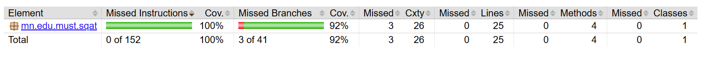

# Лаборатори №11: Mutation testing — PIT-ээр тестийн чанараа хэмжих

**Овог нэр:** _(бөглөнө)_
**Оюутны код:** _(бөглөнө)_
**Хичээл:** F.CSA313 — Программ хангамжийн чанарын баталгаа ба тест (2026)

## Ажлын орчин

```
> java -version
java version "21.0.9" 2025-10-21 LTS
Java(TM) SE Runtime Environment (build 21.0.9+7-LTS-338)
Java HotSpot(TM) 64-Bit Server VM (build 21.0.9+7-LTS-338, mixed mode, sharing)

> mvn -version
Apache Maven 3.9.12 (848fbb4bf2d427b72bdb2471c22fced7ebd9a7a1)
Maven home: C:\Program Files\apache-maven-3.9.12
Java version: 21.0.9, vendor: Oracle Corporation, runtime: C:\Program Files\Java\jdk-21
```

Үйлдлийн систем: Windows 11. PIT-ийг ажиллуулахдаа төслийн замд хоосон зай, хаалт (`starter (1)`) байхад
"No mutations found" алдаа гарсан тул төслийг хоосон зайгүй зам руу (`test_lab_11/lab11-pit`) задалж ажилласан.
`pom.xml` болон `src/main`-д ямар ч өөрчлөлт хийгээгүй.

## Эхний хэмжилт

```
mvn clean verify                                   -> results/mvn-verify-start.txt, results/jacoco-start.csv
mvn test-compile org.pitest:pitest-maven:mutationCoverage -> results/pit-start.txt
```

**JaCoCo:** Line 100% (25/25), Branch 38/41 (92%)



**PIT (results/pit-start.txt):**

```
>> Line Coverage (for mutated classes only): 25/25 (100%)
>> Generated 63 mutations Killed 17 (27%)
>> Mutations with no coverage 0. Test strength 27%
```

**Ажиглалт:** Line coverage 100% боловч mutation coverage ердөө 27% (63-аас 17 мутант алагдсан) байна.
Энэ нь тестүүд кодын мөр бүрийг *ажиллуулж* байгаа ч гаралтыг нь бараг *шалгахгүй* байгааг харуулж байна —
`assertNotNull`, `assertTrue(0 <= x <= 100)` зэрэг сул assertion-ууд кодын утга буруу болсон ч тэнцсээр байна.
Өөрөөр хэлбэл хамралт нь "код ажилласан эсэх"-ийг, mutation score нь "алдааг тест барьж чадах эсэх"-ийг хэмждэг.

## A: Амьд мутантуудын ангилал

Эхний хэмжилтэд 63 мутантаас **46** нь амьд үлдсэн (SURVIVED). Мөрийн дугаар нь
`ScholarshipCalculator.java`-ийн мөр.

| Мөр | Код | Мутаци (PIT-ийн тайлбар) | Тоо | Ангилал | Арга хэмжээ |
|---|---|---|---|---|---|
| 20 | `score < 0 \|\| score > 100` | changed conditional boundary (`<` → `<=`, `>` → `>=`) | 2 | Тест дутуу | `letterGrade(0)`, `letterGrade(100)` хүчинтэй гэж шалгах зааг тест |
| 23 | `score >= 90` | changed conditional boundary; removed conditional (true/false); replaced return value with "" | 4 | Тест дутуу | `assertEquals("A", ...)`; 90 / 89.99 зааг тест |
| 24 | `score >= 80` | changed conditional boundary; removed conditional (true/false); replaced return value with "" | 4 | Тест дутуу | `assertEquals("B", ...)`; 80 / 79.99 зааг тест |
| 25 | `score >= 70` | changed conditional boundary; removed conditional (true/false); replaced return value with "" | 4 | Тест дутуу | `assertEquals("C", ...)`; 70 / 69.99 зааг тест |
| 26 | `score >= 60` | changed conditional boundary; removed conditional (true/false); replaced return value with "" | 4 | Тест дутуу | `assertEquals("D", ...)`; 60 / 59.99 зааг тест |
| 27 | `return "F"` | replaced return value with "" | 1 | Тест дутуу | `assertEquals("F", ...)` |
| 36 | `switch (letterGrade(s))` | Changed switch default to be first case | 1 | Тест дутуу (B2-ийн дараа дахин шалгана) | Зөвхөн F дүнтэй `gpa` = 0.0 гэж яг утгаар шалгах |
| 38 | `total += 3` (B) | Replaced double addition with subtraction | 1 | Тест дутуу | `gpa({85}) == 3.0` яг утга |
| 40 | `total += 1` (D) | Replaced double addition with subtraction | 1 | Тест дутуу | `gpa({65}) == 1.0` яг утга |
| 44 | `return total / scores.length` | replaced double return with 0.0d | 1 | Тест дутуу | `gpa`-г `assertEquals(..., 1e-9)`-ээр яг утгаар шалгах |
| 48 | `gpa < 0 \|\| gpa > 4 \|\| credits < 0` | changed conditional boundary ×2 (`gpa < 0`, `credits < 0`); removed conditional ×1 | 3 | Тест дутуу | gpa = 0, credits = 0 хүчинтэй; gpa = -0.1 алдаа шиддэг гэж шалгах |
| 51 | `if (hasViolation) return 0` | removed conditional (equality → true / false) | 2 | Тест дутуу | Зөрчилтэй → яг 0, зөрчилгүй → яг 100 гэж шалгах |
| 52 | `gpa >= 3.8 && credits >= 15` → 100 | changed conditional boundary ×2; removed conditional ×4; replaced int return with 0 | 7 | Тест дутуу | `assertEquals(100, ...)`; 3.8/15, 3.79/15, 3.8/14 зааг тест |
| 53 | `gpa >= 3.4 && credits >= 12` → 70 | changed conditional boundary ×2; removed conditional ×4; replaced int return with 0 | 7 | Тест дутуу | `assertEquals(70, ...)`; 3.4/12, 3.39/12, 3.4/11 зааг тест |
| 54 | `gpa >= 3.0` → 50 | changed conditional boundary; removed conditional (true/false); replaced int return with 0 | 4 | Тест дутуу | `assertEquals(50, ...)`; 3.0 / 2.99 зааг тест |
| | | **Нийт** | **46** | | |

**Ангиллын үндэслэл:**

- **Мөр 20, 48 (оролтын хязгаар) — тест дутуу:** `<` → `<=` өөрчлөлт нь 0 оноо, 0 голч, 0 кредит гэх хүчинтэй оролтод
  алдаа шидэх болгож бодит зан төлөвийг өөрчилдөг тул тест дутуу; одоогийн тестүүд эдгээр зааг утгыг огт өгдөггүй.
- **Мөр 23–27 (letterGrade) — тест дутуу:** "" буцаах, нөхцөлийг true/false болгох нь буцаах үсгэн дүнг өөрчилдөг ч
  `assertNotNull` зөвхөн null биш эсэхийг шалгадаг тул тест дутуу (сул assertion).
- **Мөр 36–44 (gpa) — тест дутуу:** нэмэхийг хасах болгох, 0.0 буцаах нь голчийн утгыг өөрчилдөг ч
  `assertTrue(0 <= g <= 4)` муж шалгалт тэр утгуудыг зөвшөөрдөг тул тест дутуу.
  Мөр 36-ийн switch мутант нь String switch-ийн аль хэсэгт хийгдсэнээс хамаарч equivalent байж магадгүй тул
  B2-ийн дараа (F дүнг яг утгаар шалгасны дараа) амьд үлдвэл equivalent гэж дахин ангилна.
- **Мөр 51–54 (scholarship) — тест дутуу:** 100/70/50-г 0 болгох, нөхцөлийг солих нь тэтгэлгийн хувийг өөрчилдөг ч
  `assertTrue(0 <= s <= 100)` бүх боломжит хариуг зөвшөөрдөг, мөн 3.8/15, 3.4/12, 3.0 зааг утгууд тестлэгдээгүй тул тест дутуу.

Эхний шинжилгээгээр **equivalent мутант олдсонгүй** — 46 амьд мутант бүгд бодит зан төлөвийг өөрчилдөг тул сул assertion
эсвэл зааг утгын тест дутуугаас үүдэлтэй.
